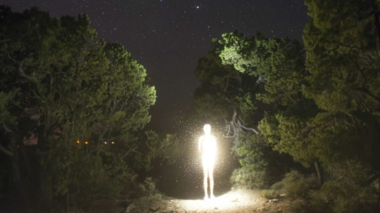
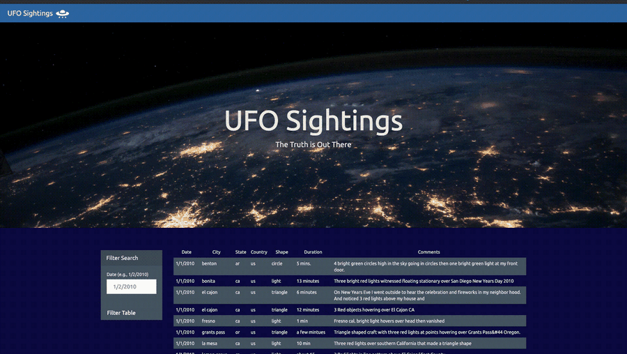
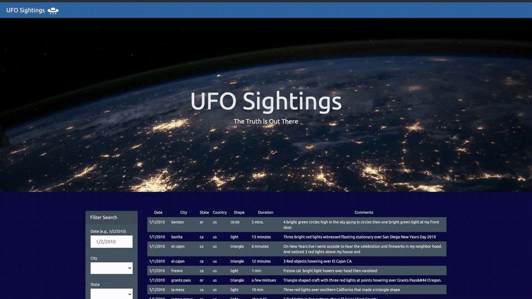

# UFO Sightings: Interactive Data Table


A dynamic web page that loads **111 eyewitness UFO reports** (1–13 January 2010) into a searchable table, built with plain JavaScript and **D3.js** DOM manipulation.



## Features

| | Level 1: date search | Level 2: multi-filter search |
|---|:---:|:---:|
| Table built dynamically from a JavaScript data array | ✅ | ✅ |
| Filter by date | ✅ | ✅ |
| Filter by city, state, country and shape (auto-populated dropdowns) | | ✅ |
| Combine any filters | | ✅ |

### Level 1: date search



### Level 2: multi-filter search



## How it works

- [`data.js`](UFO-level-2/static/js/data.js) holds the dataset as an array of objects with `datetime`, `city`, `state`, `country`, `shape`, `durationMinutes` and `comments`.
- [`utils.js`](UFO-level-2/static/js/utils.js) builds one table row per sighting with D3, fills the dropdowns with sorted unique values, and decodes HTML character codes stored in the comments (e.g. `&#44` → `,`).
- [`app.js`](UFO-level-2/static/js/app.js) stores the filter inputs and, when **Filter Table** is clicked, hides every row that doesn't match all of the active filters (case-insensitive).

## Getting started

There's nothing to install or build. Clone the repo and open either page in a browser:

```bash
git clone https://github.com/ermiasgelaye/javascript-challenge.git
open javascript-challenge/UFO-level-2/index.html     # macOS; or double-click the file
```

Or serve the folder locally with `python -m http.server`.

## Project structure

```
javascript-challenge/
├── UFO-level-1/            # date filter only
│   ├── index.html
│   └── static/{css,js,images}
├── UFO-level-2/            # multiple filters
│   ├── index.html
│   └── static/{css,js,images}
├── level1.gif, level2.gif  # demo recordings
└── alien_human-768x432.jpg
```

## Author

**Ermias Gelaye** · [Portfolio](https://ermiasgelaye.github.io) · [GitHub](https://github.com/ermiasgelaye)
